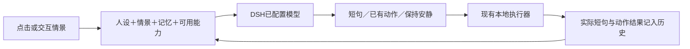

# 桌宠能力交由模型决策 / R3 后的增量方案

2026-11-03，Asia/Shanghai。用户新增方向：桌宠提供说话和动作等能力，由模型结合情景决定如何使用，增加连续性和陪伴感。当前只完成公开项目调研与增量设计，未修改 R3 原型/运行合同，未发起真实模型请求。

主控已在 first-skin-design-reacceptance-r3-2026-11-03.md 确认原 D-R2-01/02/03 通过基础配置设计阶段；本需求单独补充，不重开未受影响的原返工检查。全身服装仍是候选。

## 用户确认与当前执行

2026-11-03，用户回复“同意”，确认核心方向和先做最小闭环。皮肤线补独立R4配置/交互原型；真实DSH模型调用与原生执行接入交主控协调对应模块。R3已验收代码保持不变。具体服装、全部主动行为和完整动画没有随本次确认被记为已验收。

## 公开实现的实际情况

以 GitHub 公开仓库、检索时的 star 数及固定提交源码抽样，star 不代表安装量或兼容性。仅阅读源代码与文档，没有安装这些桌宠。

| 项目 / 固定版本 | 已确认的模型参与 | 范围与可复用点 |
|---|---|---|
| [PC2005-cloud/dsh-pet](https://github.com/PC2005-cloud/dsh-pet)，检索时5435 stars；main 31aa345b11a18fc16d5fd35c42b8b9441071170e；最新发布 v0.4.1 | 人设化对话、定时碎碎念、历史轮数；对话可把当前宠物动作清单交模型按情景选择。v0.4.1 的 CONFIG.md 与 chat-action.ts 也已有该功能。 | 最接近本轮想法：能力清单→模型选择→解析动作→既有播放链。复用其设计及小型逻辑时保留 MIT 声明；本轮尚未拷入运行代码。代码许可和角色/视频资源分开。 |
| [MerZlin/dsh-pet-indesktop](https://github.com/MerZlin/dsh-pet-indesktop)，检索时3032 stars；main 34d810b1eadd98d00e7cb9b3b51428a45b5bf03e | AI聊天、情景/时间/记忆注入、可选识屏陪伴；源码有人设和场景卡。 | 派生自 PC 项目，不能当成完全独立的架构样本。README明确自言自语来自本地配置，动作仍有本地状态/随机链；macOS/Linux真实GUI未完整验收。记忆与情景组织可参考，原生窗口不替换本项目底座。 |
| [Rymascot/dsh-dpet](https://github.com/Rymascot/dsh-dpet)，检索时9 stars；810aacc1ccb6279dac35ca3b4b1ac06ebbea2c8e | 给 DSH Agent 注册 status/update/import/manage 四个桌宠工具，让模型按用户要求调整角色和动作编排。 | 作为能力工具接口样本，不称热门榜首或持续自主桌宠。使用官方 defineTool/ctx.tools.register，插件本身不额外调用模型；工具描述限制只在用户要求时更改。代码标识 Apache-2.0，适配时保留对应声明。 |

因此，已有热门项目实现“模型按情景说话并挑动作”，也有确定性状态联动、模型工具配置等路线；不足以说所有热门桌宠都把整套自主行为交给模型。完整检索元数据、提交与12条源码入口在 reports/first-skin/llm-pet-research-2026-11-03.json。

## PC2005-cloud/dsh-pet 的人设、记忆和动作上下文

- **人设可配置**：whisperPrompt。实例自己的 pets[].whisperPrompt 优先，未设时回所属种类/条目人设；对话和碎碎念共用它，生成时附加名字和当前时间。见 [persona.ts](https://github.com/PC2005-cloud/dsh-pet/blob/31aa345b11a18fc16d5fd35c42b8b9441071170e/dsh-pet/src/host/persona.ts)。
- **聊天记忆可配置**：chatMemoryRounds，当前包内默认配置为10轮，一轮是一问一答。0表示生成时不带历史，聊天存档仍在本地。按种类与宠物实例分别记录，不是所有宠物共用一段对话。见 [默认配置](https://github.com/PC2005-cloud/dsh-pet/blob/31aa345b11a18fc16d5fd35c42b8b9441071170e/dsh-pet/assets/config.jsonc#L49) 和 [记忆与生成](https://github.com/PC2005-cloud/dsh-pet/blob/31aa345b11a18fc16d5fd35c42b8b9441071170e/dsh-pet/src/host/plugin/chat-memory.ts)。这是持久化聊天历史和截取最近轮次，本轮没有发现 PC 项目在这条路径实现语义长期记忆提炼/RAG。
- **动作选择有上下文**：同一次生成携带人设、时间、最近对话、当轮文字/可选图片，以及本宠物可执行的动作清单。过去模型选过的动作名也会作为历史标记回填，后续要求换一个时有据可依。见 [chat.ts](https://github.com/PC2005-cloud/dsh-pet/blob/31aa345b11a18fc16d5fd35c42b8b9441071170e/dsh-pet/src/host/chat.ts)。
- **动作有开关与真实清单**：chatAnimationEnabled 默认true，动作来自 animations.categories，模型可选一个，也可不选；只有有效名称进入既有播放链，不把标记作为用户正文。见 [发布版配置](https://github.com/PC2005-cloud/dsh-pet/blob/v0.4.1/CONFIG.md#L52) 与 [动作选择器](https://github.com/PC2005-cloud/dsh-pet/blob/31aa345b11a18fc16d5fd35c42b8b9441071170e/dsh-pet/src/host/chat-action.ts)。这个清单不包含全部移动、拖拽或事件动画，不能解释成模型掌管所有行为。
- **定时碎碎念的上下文较轻**：generateWhisper 接收人设和功能指令/配图信息，没有聊天 history 或动作清单参数；梦话也是这一路。需要让主动情景共享记忆时，本项目应明确把什么上下文传进去。见 [whisper.ts](https://github.com/PC2005-cloud/dsh-pet/blob/31aa345b11a18fc16d5fd35c42b8b9441071170e/dsh-pet/src/host/whisper.ts)。

## 本项目的增量分工

模型负责选择说什么、做哪个已支持动作、是否安静，以及允许范围内的简短动作组合；本地负责坐标、播放、动作结束、停止/恢复和反馈结果。继续复用现有配置、资源、生命周期、授权及执行器。皮肤声明真实提供的能力和语义说明；没有资源的形象、动作和工具不进入清单。

| 模式 | 适用体验 | 本轮取舍 |
|---|---|---|
| 本地 | 安静、即时、无需模型时的陪伴；沿用现有规则 | 保留已有能力，作为关闭智能与请求失败时的简明回退。 |
| 模型 | 允许模型按人设、情景和记忆选择能力，主动性可调 | 用户明确希望提供的方向；持续自主决策的触发/频率需要独立收敛。 |
| 混合 | 待机/物理由本地运行，点击和说话等情景让模型决策 | 建议首个闭环采用此分工；先做一种智能互动，不承诺一次实现所有模式和后台自主玩法。 |

## 配置围绕角色和能力

首个闭环先保留少量必要配置：智能互动开关、行为人设、跟随当前DSH模型或指定模型、最近带几轮历史，以及说话/已有动作两种能力是否允许。既有外观和停止设置继续生效。

后续再根据真实体验展开主动程度、触发情景、勿扰时段、每小时调用上限、情景摘要及偏好记忆。固定事件映射留作高级覆盖/回退，主要交互由模型按上下文选择；不以字段数量作为交付目标。移动、提醒、声音、识屏等能力按实际模块和资源逐项开放，不自动并入首个实现。

模型调用复用 DSH 的模型目录、当前选择与 ctx.llm；工具注册参考 DPet 的 defineTool/ctx.tools.register 接入方式。配置和每皮肤覆写继续使用已有机制；模型短记忆归桌宠模块，保留角色与实例边界。与目标 DSH 0.2.1-rc.5 的接口兼容仍需隔离验证，本轮未实施。

## 最小闭环与可观察验收

先做一组连续互动：用户点一下角色→模型看到人设、最近互动和当前可用动作→决定一句短回应及动作或安静→本地执行→把实际结果纳入下一次上下文。再让用户说换个动作或延续刚才的话，验证模型确实收到前一次选择，而非每次从零猜测。

必要检查只覆盖这条真实场景：模型请求和回复发生过、选择来自已就绪资源、后续对话收到历史动作、关闭智能仍能本地回应、等待回复时停止不会被晚返回重新唤起。请求失败直接用既有本地回退并说明结果；不为这一步另建通用 Agent 平台或扩大故障矩阵。

原会话的需处理提示、全局停止与不可用状态继续由已验收的执行状态控制。模型可以生成提示短句，原状态需要真实解除事件才能改变。idle/react少量完整动作可独立试制，不等全部未来能力齐备后才做素材。

本文件是新增方向的设计提案。R3原返工复审已通过；真实模型闭环、模型驱动能力、完整动画和新角色原生接入仍没有验收结论。没有修改真实安装/profile、R3代码或旧交付快照，未提交或发布。
